# SRAG, município do Rio de Janeiro

Série histórica (**2019 em diante**) da base de **SRAG (OpenDATASUS)** recortada para o
**município do Rio de Janeiro** (código IBGE 330455). Este branch (`mrj`) usa o mesmo
pipeline do branch `main`, que cobre a RIDE-DF, com o recorte territorial trocado.

O bruto nacional é baixado, filtrado e só os recortes enxutos são versionados, em
**parquet**, um arquivo por ano.

## O que muda em relação ao `main`

| Item | `main` (RIDE-DF) | `mrj` (município do Rio) |
|---|---|---|
| Recorte | 34 municípios da RIDE-DF | Rio de Janeiro (330455) |
| Critério de inclusão | notificação **ou** residência no recorte | igual |
| `territorio_residencia` | DF, RIDE-GO, RIDE-MG, fora da RIDE | Município do Rio de Janeiro, outros municípios do RJ, outras UFs, residência ignorada |
| `territorio_notificacao` | igual ao anterior, pela notificação | mesmas categorias, pela notificação |
| `ra_residencia`, `populacao_ra` | Região Administrativa do DF e sua população | removidas |
| `populacao_residencia` | população do município de residência | 6.729.894 (IBGE, Estimativas 2024) para residentes no Rio; vazio para os demais |
| `municipio_notificacao`, `municipio_residencia` | nome da tabela de referência da RIDE | nome oficial do IBGE para os 92 municípios do RJ (`R/municipios_rj.csv`) |
| Nome dos arquivos | `srag_ride_*` | `srag_mrj_*` |
| Coluna do manifesto | `linhas_ride` | `linhas_recorte` |
| CSV do ano corrente na raiz | `dados_limpos_df.csv`, `srag_ride_pronto.csv` | não existem |

A base pronta do `mrj` tem 46 colunas. Todas existem no `main` com o mesmo nome e significado; o `main` tem 48, porque inclui também `ra_residencia` e `populacao_ra`.

## Arquitetura

```mermaid
flowchart LR
    S[Página do dataset<br/>data da última atualização] -->|01_download.R<br/>compara com o manifesto| A
    A[OpenDATASUS<br/>INFLUDaa-DD-MM-AAAA.parquet<br/>1 por ano] -->|só os anos que mudaram| B[data-raw/<br/>bruto, gitignored]
    B -->|02_filter_clean.R<br/>DuckDB| C[historico/bruto/<br/>recorte do município por ano .parquet]
    C -->|03_prepara.R<br/>só os anos alterados| P[historico/pronto/<br/>base analítica por ano .parquet<br/>+ serie_semanal.csv]
    P -->|git commit/push| D[(GitHub)]
    E[GitHub Actions<br/>manual neste branch] -.orquestra.-> S
```



Princípios:
- **Bruto nacional nunca vai para o Git.** Fica em `data-raw/` (no `.gitignore`).
- **Um arquivo por ano, em parquet (ZSTD).** Os anos antigos ficam congelados no
  OpenDATASUS por meses; separando por ano, a atualização semanal só toca os anos vivos.
- **Atualização incremental.** O `01` lê na página do dataset a revisão publicada de
  cada ano e compara com `historico/manifesto.csv`. Só baixa o ano cujo arquivo mudou;
  o `03` só refaz a base pronta dos anos cujo recorte mudou (ou de todos, se o script mudou).
- **DuckDB de ponta a ponta**: o filtro lê só as linhas do município e o preparo lê só as
  colunas que usa.

## Estrutura

```
srag_historico/
├── R/
│   ├── config.R            # código do município, descoberta das URLs, caminhos
│   ├── municipios_rj.csv   # códigos e nomes oficiais dos 92 municípios do RJ (IBGE)
│   ├── 01_download.R       # confere a última atualização e baixa o que mudou
│   ├── 02_filter_clean.R   # filtra com DuckDB -> recorte por ano
│   ├── 03_prepara.R        # derivações -> base pronta por ano + série semanal
│   └── ler_historico.R     # ler_srag_mrj(): carrega a série pronta
├── run_pipeline.R          # orquestra 01 + 02
├── historico/
│   ├── manifesto.csv                         # revisão de cada ano que está no repositório
│   ├── serie_semanal.csv                     # casos, óbitos e UTI por SE (toda a série)
│   ├── bruto/srag_mrj_bruto_AAAA.parquet     # colunas originais do Sivep
│   └── pronto/srag_mrj_pronto_AAAA.parquet   # 46 colunas analíticas
└── .github/workflows/atualizar-dados.yml
```

## Como rodar localmente

```bash
Rscript -e 'install.packages(c("duckdb","DBI","curl","jsonlite","dplyr","tidyr","stringr","lubridate","readr","httr"))'
Rscript run_pipeline.R        # baixa e filtra só o que mudou
Rscript R/03_prepara.R        # gera as bases prontas e a série semanal
```

Opções (variáveis de ambiente):

| Variável | Para quê | Padrão |
|---|---|---|
| `SRAG_ANO_INICIAL` | primeiro ano da série | `2019` |
| `SRAG_ANOS` | conferir só alguns anos, ex.: `2025,2026` | série toda |
| `SRAG_FORCAR` | `1` para rebaixar e refazer tudo | desligado |
| `SRAG_URLS` | fixar as URLs à mão (separadas por vírgula) | descoberta automática |
| `SRAG_JANELA_DIAS` | dias para trás na sondagem do S3, se o site falhar | `35` |
| `SRAG_DIR_SAIDA` | pasta de saída (`.` grava `historico/` na raiz) | automático |

No GitHub, o botão **Run workflow** aceita os mesmos `anos` e `forcar`. O agendamento
(segunda e terça) só dispara no branch padrão do repositório. Neste branch, rode o
workflow manualmente, ou mova o agendamento quando o `mrj` virar um repositório próprio.

## Como usar a série

```r
source("R/ler_historico.R")
srag <- ler_srag_mrj()                   # 2019 em diante
srag <- ler_srag_mrj(anos = 2023:2026)   # só alguns anos
srag <- ler_srag_mrj(colunas = c("periodo_se", "classificacao_final"))  # só o necessário
```

```python
import pandas as pd
df = pd.read_parquet("historico/pronto")    # Python
```

```sql
-- DuckDB; no recorte bruto use union_by_name (o tipo de algumas colunas varia por ano)
SELECT * FROM read_parquet('historico/bruto/*.parquet', union_by_name = true);
```

Para curvas históricas, `historico/serie_semanal.csv` traz a contagem por semana
epidemiológica, território de residência e classificação final.

## Notas metodológicas

- **Critério de inclusão:** município de notificação **ou** de residência igual ao Rio de
  Janeiro. Por isso a base inclui residentes de outros municípios e UFs atendidos no Rio,
  identificados em `territorio_residencia`. Para analisar só os residentes, filtre
  `territorio_residencia == "Município do Rio de Janeiro"`.
- **Semana epidemiológica:** calculada pela data dos primeiros sintomas, conforme o
  calendário oficial (domingo a sábado). O campo `SEM_PRI` do Sivep não é usado porque
  diverge do calendário na virada 2025/2026.
- **`id_caso`** nos arquivos por ano é `ano × 1.000.000 + sequência`; é único na série,
  mas não é estável entre revisões (não use como chave permanente).
- **População:** `populacao_residencia` é um valor fixo (IBGE, Estimativas 2024),
  repetido em todos os anos. Para incidência histórica, use denominadores do ano
  correspondente.
- **Bairro:** a base nacional de SRAG não traz bairro de residência, então este branch não
  tem essa dimensão. A menor unidade territorial disponível é o município. Análises por
  bairro ou Área de Planejamento precisam de outra fonte.
- **Nomes de município:** para os 92 municípios do RJ, vêm da tabela do IBGE em
  `R/municipios_rj.csv`. Para municípios de outras UFs, o nome é o da ficha, com a caixa
  corrigida e sem acento (ex.: "Sao Paulo").
- **Tipo de unidade:** `tipo_unidade` é classificado por palavras no nome da unidade
  (`NM_UN_INTE`) e é uma heurística. As regras reconhecem os padrões do Rio: CER e UPA
  como pronto-atendimento; Clínica da Família, CMS e Coordenadoria de Atenção Primária
  como APS; hospitais, institutos e unidades da Fiocruz como hospital. Cerca de 2% dos
  casos ficam em "Outro / não classificado" (centros médicos e operadoras privadas).
  Confira a classificação antes de usá-la em análises por serviço.
